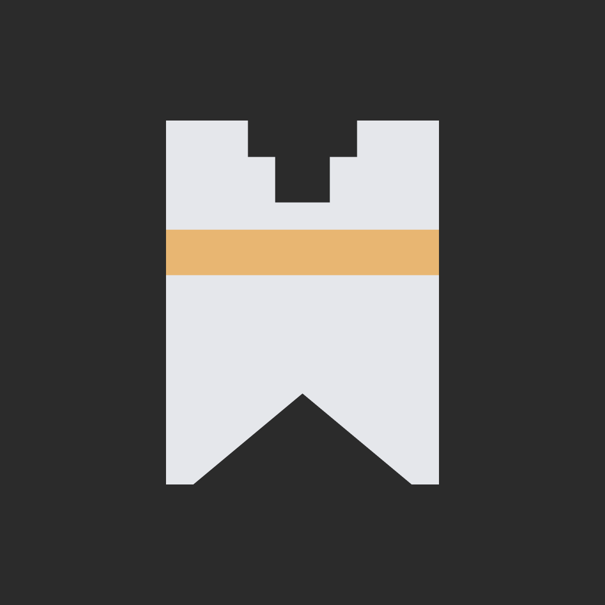
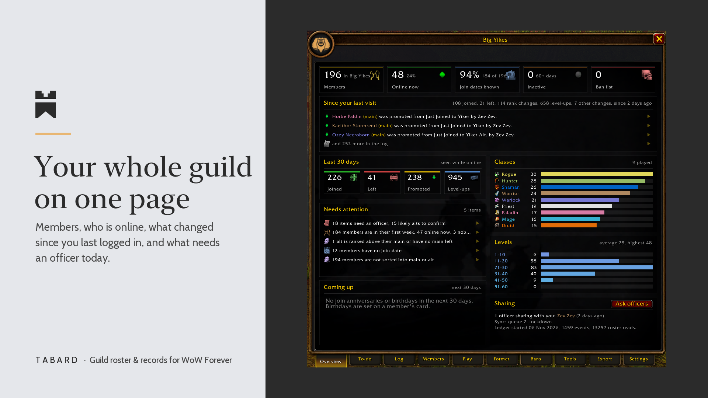
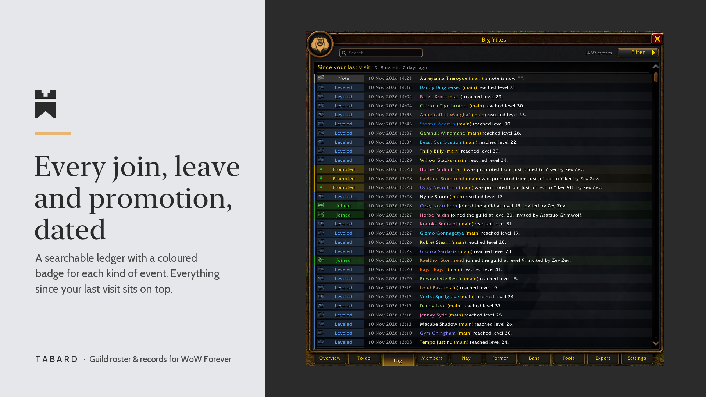
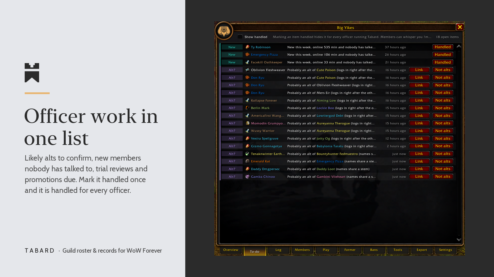
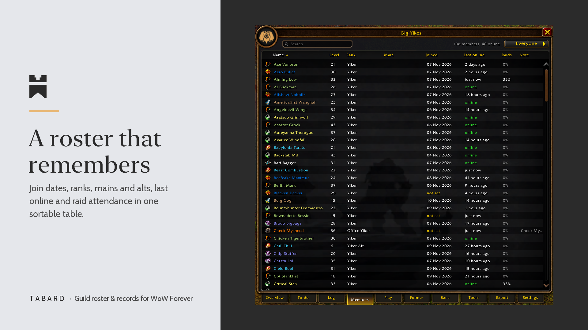
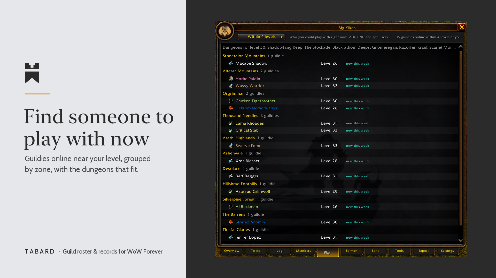
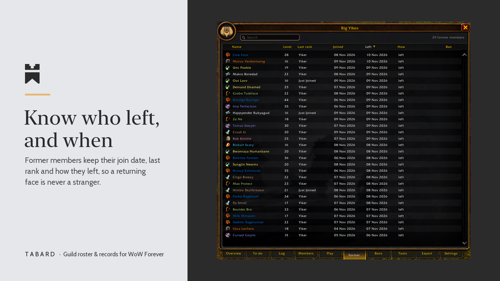
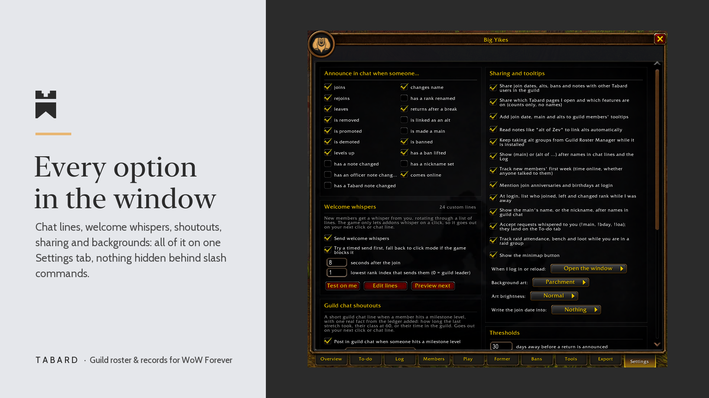

  

<h1 align="center">Tabard</h1>

  A dated record of your guild for World of Warcraft Forever, built on the stock UI.

  <a href="https://github.com/alexandermayes/tabard/releases/latest"><b>Download</b></a> ·
  <a href="https://www.curseforge.com/wow/addons/tabard-guild-roster">CurseForge</a> ·
  <a href="https://github.com/alexandermayes/tabard/issues/new/choose">Report a bug</a>

Tabard watches your guild roster while you play and writes down what happens: who joined and when, who
left or was removed, promotions, level-ups, alts and mains, name and note changes. It keeps the things
officers usually hold in their heads, and shares them with the other officers who run it.

## At a glance

- **Catch up in seconds.** Joins, leaves and rank changes from while you were offline arrive as chat lines at login.
- **Keep track of alts.** Mains and alts stay linked, and chat shows "(main)" or "(alt of X)" after names.
- **Look after new members.** Anyone online for half an hour without a hello becomes a to-do item, with a buddy suggested.
- **One list of officer work.** Trial reviews, ended leaves, banned characters and promotions due, in one place.
- **Play together.** See which guildies are online near your level, grouped by zone.
- **Know who just logged in.** One chat line when a guild member comes online, with their level and when they were last on.
- **Call people what they go by.** Give a member a nickname and it shows after their name, and their alts' names, in guild chat.
- **Shared with your officers.** Officers who run Tabard keep each other up to date automatically, and tell you when a newer Tabard is out.

## Install

**CurseForge app:** search for "Tabard: Guild Roster & Records".

**By hand:**

1. Download `Tabard-<version>.zip` from the [latest release](https://github.com/alexandermayes/tabard/releases/latest).
2. Extract it into `World of Warcraft\_forever_\Interface\AddOns\`. You should end up with
   `AddOns\Tabard\Tabard.toc`, not `AddOns\Tabard\Tabard\Tabard.toc`.
3. Restart the game, check that Tabard is ticked in the AddOns list on the character screen, and log in.
4. Type `/tabard` or click the minimap button. There is nothing to set up.

Download the zip from Releases, not GitHub's green "Code" button: that one includes this repository's
own files and names the folder `tabard-main`.

## Screens

| | |
| --- | --- |
|  |  |
| **Log:** every event with a coloured badge, searchable and filterable, with everything since your last visit above a divider. | **To-do:** likely alts, trial reviews, ended leaves, banned characters in the guild, promotions due and requests members whisper you (`!main`, `!bday`, `!loa`). |
|  |  |
| **Members:** sortable, with join dates, main and alt links, last online, raid attendance and notes. Click a row for the member card, or right-click a guild member anywhere in the game and choose "Open in Tabard". | **Play:** guildies online within 4 or 8 levels of you, grouped by zone, plus the dungeons that fit your level. |

|  |  |
| **Former members:** everyone who left or was removed keeps their join date, last rank and how they went. | **Settings:** every option in the window, nothing hidden behind slash commands. |

## Also in the box

- **Bans** with reasons, and a warning when a banned character or an alt of one joins.
- **Raids:** attendance, bench and loot tracking while you are in a raid group.
- **Tools:** inactive members, promotions due, retention by join week and who recruits people who stay.
- **Export:** comma-separated text for members, former members, the log, bans and raid attendance.
- **Welcome whispers** and **guild chat shoutouts**, both off until you turn them on.
- **Backup and restore**, and every option in the window rather than behind slash commands.

## Commands

`/tabard` opens the window. `/tabard scan`, `sync`, `status`, `import`, `todo`, `raid`, `backup`,
`restore`, `welcome`, `nick` and `usage` do what they say, and the window has the same controls.

## Coming from Guild Roster Manager

Settings has an **Import** button that brings over your join and promotion dates. Keep Guild Roster
Manager installed and Tabard keeps its alt groups in step with it.

## Good to know

- Built for WoW Forever. Libraries are bundled, so there is nothing else to install.
- WoW Forever does not let addons send chat on a timer, so welcome whispers and shoutouts go out on
  your next click or chat line. Nothing is sent unless you turn it on.
- For new members, Tabard keeps only flags and minutes, never message text.

## Bugs and ideas

Open an [issue](https://github.com/alexandermayes/tabard/issues/new/choose). For a Lua error, paste the
whole error text. Please leave out officer notes and anything else about your guildmates that should
stay private.

## Licence

[MIT](https://github.com/alexandermayes/tabard/blob/main/LICENSE). Tabard contains no code from Guild Roster Manager.
